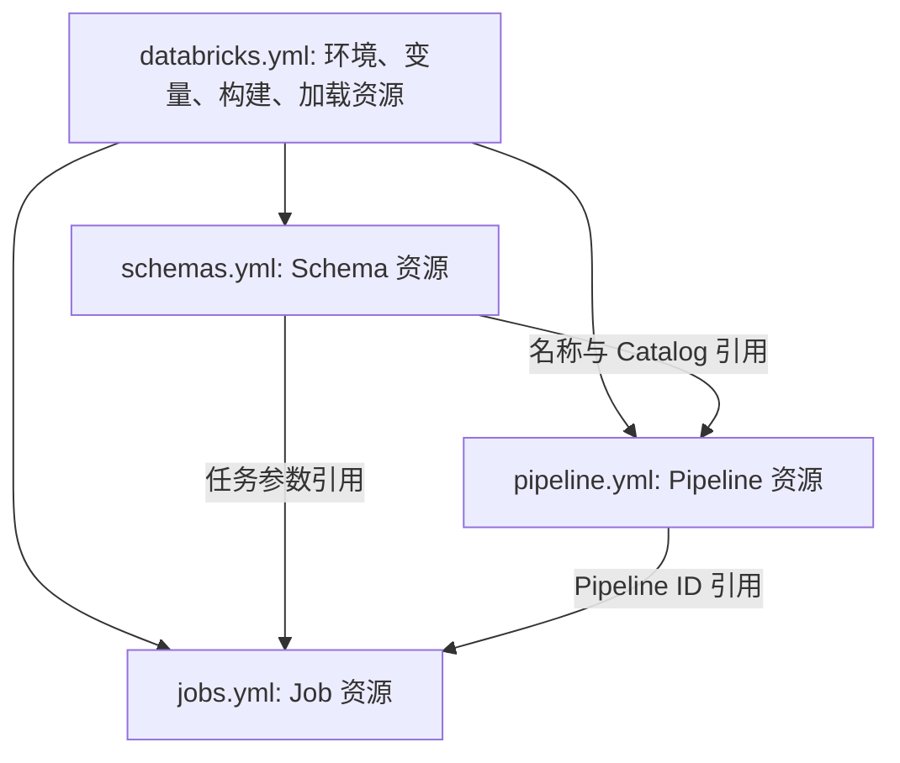

# Databricks YAML 配置说明

本文说明当前项目中四类 Databricks Bundle 配置的职责、主要字段与相互关系。

项目中的 Schema 配置文件实际名为 `resources/schemas.yml`，不是 `schema.yml`。

## 一、总体区别

| 文件 | 主要回答的问题 | 定义的内容 |
| --- | --- | --- |
| [databricks.yml](databricks.yml) | 项目部署到哪里、如何打包？ | Bundle、环境、变量、运行身份、构建和同步规则 |
| [resources/schemas.yml](resources/schemas.yml) | 数据放在哪些命名空间？ | 五个 Unity Catalog Schema 及其生命周期保护 |
| [resources/pipeline.yml](resources/pipeline.yml) | 数据处理 Pipeline 如何运行？ | 计算资源、代码入口、默认命名空间和运行配置 |
| [resources/jobs.yml](resources/jobs.yml) | 执行哪些任务、如何控制执行？ | Job、任务类型、参数、环境、并发、超时和重试 |

这些文件共同组成一个部署配置，不是四个依次执行的 Python 程序。文件拆分主要为了方便维护，Bundle 会加载并解析它们之间的引用。

## 二、databricks.yml：项目入口与环境配置

[databricks.yml](databricks.yml) 是 Bundle 的入口文件。

| 配置 | 当前项目中的作用 |
| --- | --- |
| `bundle.name` | 将项目标识为 `ecommerce-lakehouse` |
| `bundle.engine` | 使用 `direct` 部署引擎 |
| `artifacts.lakehouse` | 通过 `python3 -m build --wheel` 构建 Python wheel 包 |
| `variables` | 声明 Catalog、各层 Schema、Pipeline 名称、Job 环境版本和生产运行身份等变量 |
| `include` | 加载 `resources/*.yml`，也包括开发演示配置 |
| `sync` | 显式包含源码、演示脚本、资源配置和入口文件；它不是 Git 跟踪配置 |
| `targets` | 定义 `dev`、`prod` 两套部署环境 |

### 开发环境与生产环境

| 项目 | dev | prod |
| --- | --- | --- |
| 是否默认目标 | 是 | 否 |
| 模式 | `development` | `production` |
| Catalog | 已有的 `workspace` | 已有的 `ecommerce_lakehouse` |
| Schema 基础名称 | `ecommerce_bronze_dev` 等 | 使用变量默认值，如 `bronze`、`silver` |
| 部署根目录 | 当前用户的个人目录 | `/Shared/prod/bundles/ecommerce-lakehouse-prod` |
| 显式运行身份 | 当前文件未配置 `run_as` | `${var.prod_run_as_sp}` 指定的 Service Principal |

开发模式可能为资源名称添加前缀，因此实际部署名称应以解析后的资源配置为准，不能只看变量里的基础名称。

`catalog` 变量只是引用已有 Catalog，并不创建 Catalog。生产部署需要另外提供有效的 Service Principal 和工作区连接配置；当前 `prod` 没有显式设置 `workspace.host`。

`serverless_environment_version` 默认值为 `"4"`，在本项目中用于 Job 的 Serverless Python 环境，不是 Databricks Connect 包版本。

## 三、schemas.yml：数据命名空间

[resources/schemas.yml](resources/schemas.yml) 通过 `resources.schemas` 声明五个 Schema。

| Schema 资源标识 | 用途 |
| --- | --- |
| `bronze` | 保存原始数据，例如订单、用户、商品和点击流原始表 |
| `silver` | 保存清洗和标准化后的数据 |
| `gold` | 保存明细宽表和业务聚合结果 |
| `semantic` | 保存指标视图等语义层对象 |
| `rag` | 预留给 RAG 相关数据；声明 Schema 不等于已经实现对应处理流程 |

每个 Schema 的配置结构如下：

```yaml
bronze:
  name: ${var.bronze_schema}
  catalog_name: ${var.catalog}
  lifecycle:
    prevent_destroy: true
```

- `bronze` 是 Bundle 内的资源标识，不一定等于远端 Schema 的实际名称。
- `name` 和 `catalog_name` 从当前目标环境的变量取值。
- `prevent_destroy: true` 用于阻止 Bundle 执行销毁该 Schema 的操作，不是数据备份，也不能防止所有外部删除操作。

该文件管理命名空间，不生成模拟数据，也不定义业务表的清洗和汇总规则。Schema 资源已经纳入部署管理，因此常规刷新不必先运行初始化 Job。

## 四、pipeline.yml：数据处理配置

[resources/pipeline.yml](resources/pipeline.yml) 声明一个 Pipeline，资源标识是 `ecommerce_lakehouse_main`。

| 配置 | 含义 |
| --- | --- |
| `name` | 通过 `${var.pipeline_name}` 指定显示名称；资源标识与显示名称是两个概念 |
| `catalog`、`schema` | 默认使用 Gold 所属的 Catalog 和 Schema；代码仍可显式指定其他 Schema |
| `serverless: true` | 使用 Serverless 计算资源 |
| `edition: ADVANCED` | 使用支持数据质量约束等能力的功能级别 |
| `root_path` | 指定远端源码根目录，并加入 Pipeline 的 Python 模块搜索路径 |
| `libraries` | 加载 Silver、Gold 两个 Pipeline 定义文件 |
| `configuration` | 为 Pipeline 的 Spark 会话提供时区和自定义业务配置 |

### root_path 的来源

```yaml
root_path: ${workspace.file_path}/src
```

`${workspace.file_path}` 是 Bundle 内置的路径替换值。未显式覆盖时，文件目录默认位于 `${workspace.root_path}/files`。

因此 Pipeline 的根目录类似：

```text
/Workspace/Users/<用户名>/bundles/ecommerce-lakehouse-dev/files/src
```

这是部署到 Databricks 后的远端路径，不是电脑上的本地源码路径。它让 Pipeline 可以导入 `src` 下的 `ecommerce_lakehouse` 包。

### configuration 最后由谁使用

- `spark.sql.session.timeZone: UTC` 由 Spark 使用，控制会话时区。
- `ecommerce.catalog` 和 `ecommerce.*_schema` 是项目自定义配置，供 Python 代码通过 `spark.conf.get()` 读取。

[config.py](src/ecommerce_lakehouse/config.py) 中的 `pipeline_namespace()` 读取这些值并拼接命名空间。[silver_layer.py](src/pipelines/silver_layer.py) 据此确定 Bronze 输入表和 Silver 输出表；[gold_layer.py](src/pipelines/gold_layer.py) 据此确定 Silver 输入表和 Gold 输出表。

这些配置仅属于该 Pipeline 的运行环境，不会自动传给独立 Job 或本地 Databricks Connect 会话。

具体清洗、关联和聚合规则在 [Silver 转换代码](src/ecommerce_lakehouse/transforms/silver.py) 和 [Gold 转换代码](src/ecommerce_lakehouse/transforms/gold.py) 中。YAML 配置运行环境和入口，Python 定义处理规则。

## 五、jobs.yml：任务执行与编排

[resources/jobs.yml](resources/jobs.yml) 当前定义四个独立 Job。

| Job 资源标识 | 任务类型 | 作用 |
| --- | --- | --- |
| `initialize_lakehouse` | `python_wheel_task` | 调用 `initialize` 入口，初始化 Schema；保留作独立初始化或修复入口 |
| `ecommerce_refresh` | `pipeline_task` | 启动 Pipeline，刷新 Silver、Gold |
| `semantic_refresh` | `python_wheel_task` | 调用 `publish_semantic` 入口，发布指标视图 |
| `delta_maintenance` | `python_wheel_task` | 调用 `maintain_delta` 入口，维护指定 Bronze 表 |

### 两种任务类型

`python_wheel_task` 执行打包后的 Python 入口：

- `package_name` 指定安装的包，本项目为 `ecommerce_lakehouse`。
- `entry_point` 指定入口名称，映射定义在 [pyproject.toml](pyproject.toml) 的 `[project.scripts]` 中。
- `parameters` 传命令行参数，例如 Catalog、Schema 和表名。
- `environment_key` 引用 Job 中声明的 Serverless Python 环境。
- 环境依赖 `../dist/*.whl` 提供构建好的项目包；它与 Pipeline 的源码文件入口不同。

`pipeline_task` 则通过 `${resources.pipelines.ecommerce_lakehouse_main.id}` 引用已部署的 Pipeline，不是直接执行一个 wheel 入口。

其中 `full_refresh: false` 表示不请求完整重置刷新，不等于保证所有处理都只是追加数据；具体更新行为取决于数据集类型和处理逻辑。

### 执行控制

| 配置 | 含义 |
| --- | --- |
| `max_concurrent_runs: 1` | 限制同一个 Job 的并发运行数，不是整个项目只能运行一个 Job |
| `queue.enabled: true` | 启用运行排队机制 |
| Job 级 `timeout_seconds` | 限制整个 Job 的运行时间 |
| 任务级 `timeout_seconds` | 限制单个任务的运行时间 |
| `max_retries` | 控制任务失败后的重试次数 |
| `min_retry_interval_millis` | 设置任务重试的最小间隔 |

`&default_environment` 和 `*default_environment` 是 YAML 锚点与别名，用来复用环境定义；它们不表示任务依赖或执行顺序。

### 触发条件与任务顺序

`ecommerce_refresh` 已配置每天北京时间（`Asia/Shanghai`）上午 08:00 触发，Quartz 表达式为 `0 0 8 * * ?`，`pause_status` 为 `UNPAUSED`。该调度需部署后才在远端生效，当前配置会应用于加载此 Job 的 dev 和 prod 目标。

`delta_maintenance` 已配置每天北京时间晚上 22:00 触发，Quartz 表达式为 `0 0 22 * * ?`，`pause_status` 为 `UNPAUSED`。对四张指定 Bronze 表先执行 `OPTIMIZE`，再执行 `VACUUM ... RETAIN 168 HOURS`；Pipeline 管理的表仍会跳过。该调度和清理参数同样需部署后才在远端生效，并适用于加载此 Job 的 dev 和 prod 目标。

七天保留期针对已不再被当前表引用的数据文件，不是删除七天前的业务记录。清理后可能无法回溯到依赖这些文件的旧版本；启用前应确认长时间运行的读取、写入和流式任务不依赖超过保留期的文件。

`initialize_lakehouse` 和 `semantic_refresh` 没有配置定时调度。这四个 Job 没有相互串联，文件中的排列顺序不代表执行顺序。

需要定时运行时，应在 Job 中配置 `schedule`；文件到达、表更新或持续运行等触发方式也应在 Job 层按需求配置，不要同时使用相互冲突的调度方式。

同一个 Job 内的任务顺序通过 `depends_on` 明确声明。当前 `jobs.yml` 中每个 Job 都只有一个任务。

项目另有 [resources/demo.yml](resources/demo.yml)，定义开发演示的生成数据、刷新 Pipeline 和发布语义层的任务依赖。这是单独的演示流程，不代表上述四个 Job 会自动依次执行。

## 六、资源引用与部署关系



这些引用让 Bundle 能识别资源间的部署依赖，但不等于业务任务已经按顺序启动。

例如：

```text
${var.gold_schema}                         环境相关的变量值
${resources.schemas.gold.name}             Schema 资源解析后的名称
${resources.pipelines.ecommerce_lakehouse_main.id}  Pipeline 资源的 ID
${workspace.file_path}                     Bundle 的远端文件目录
${bundle.target}                           当前目标名称，如 dev 或 prod
```

## 七、如何选择修改位置

| 需求 | 主要修改位置 |
| --- | --- |
| 更换工作区、部署环境、Catalog 或 Schema 基础名称 | `databricks.yml` |
| 增加 Schema 或调整其生命周期保护 | `resources/schemas.yml` |
| 增加 Pipeline 源码入口、调整运行配置 | `resources/pipeline.yml` |
| 调整数据清洗、关联或聚合规则 | `src` 下的 Python 转换代码 |
| 增加定时触发、任务参数、超时或重试策略 | `resources/jobs.yml` |
| 调整开发演示的串联流程 | `resources/demo.yml` |

配置改动后可先检查：

```bash
databricks bundle validate -t dev
```

该命令用于校验和解析配置，不会部署或执行数据处理任务；校验通过也不等于已经完成运行时测试。